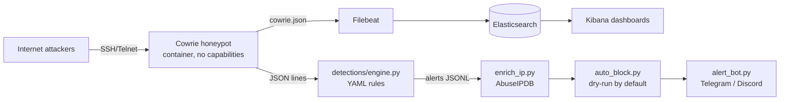

# Architecture

## Design decisions

- **Two detection paths.** Kibana gives exploration and visuals; the Python engine gives
  portable, unit-tested rules that run in CI with no infrastructure. Keeping rule logic in
  version-controlled YAML makes detections reviewable like code.
- **JSONL filters.** Each automation step reads alerts on stdin and writes them on stdout,
  so stages can be reordered, replaced, or run independently.
- **Safe response.** `auto_block.py` is dry-run unless `--apply`, validates every IP, never
  uses a shell, and refuses private and allowlisted addresses.
- **Isolation.** Honeypot runs unprivileged in a container on a dedicated VPS with no route
  to other systems. Elastic ports bind to localhost only.
- **Hashes, not binaries.** Captured samples stay in the Docker volume; the repo stores
  SHA-256 hashes only.
